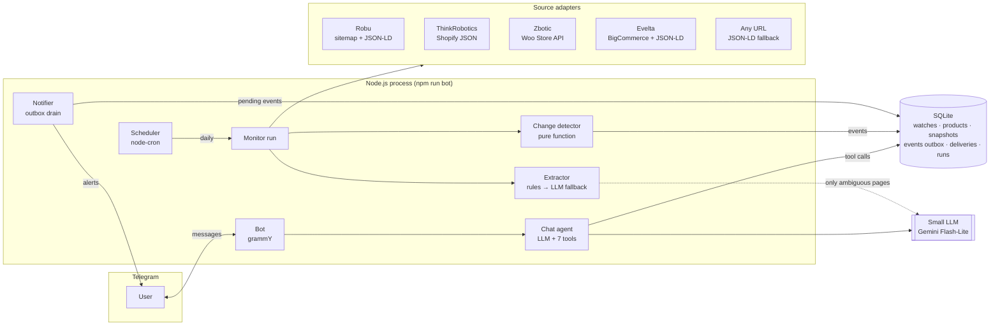

# Drone Parts Shopping Assistant

A lightweight assistant that monitors Indian drone-parts retailers (Robu.in, ThinkRobotics, Zbotic, Evelta) for stock changes, alerts users on **Telegram** when a watched product comes back in stock or opens for pre-order, and lets them **search, filter, compare and manage their watchlist by chatting** with the same bot.

```
You:  show me in-stock flight controllers under 20000
Bot:  • Robu.in | 🟢 ₹1,999 | NX4 EVO Flight Controller [#81]
      • ThinkRobotics | 🟢 ₹2,190 | NX3 3D Flight Controller [#86]
      • Evelta | 🟢 ₹10,343 | Pixhawk 2.4.8 PX4 Autopilot [#103] ...

You:  watch https://robu.in/product/holybro-pixhawk-6c-mini-flight-controller/
Bot:  ✅ Now watching: Holybro Pixhawk 6C Mini Flight Controller
      🔴 Holybro Pixhawk 6C Mini Flight Controller · Robu.in · ₹28,269

(days later)
Bot:  🟢 Back in stock
      Holybro Pixhawk 6X Pro Flight Controller (FC only)
      Zbotic · ₹94,498.95 — was: out of stock
```

---

## Architecture



**One monitoring run** (`src/monitor/run.ts`):

1. **Discover**: every *query* watch ("Pixhawk 6X") is searched on all stores in parallel; new listings are registered.
2. **Check**: each tracked product page is fetched (stores in parallel, products within a store sequentially and rate-limited).
3. **Extract**: adapters report raw *signals*; rules turn them into a status; the LLM is consulted only when signals are missing or contradict each other.
4. **Detect**: a pure function classifies the transition (`back_in_stock`, `preorder_opened`, `price_drop`, `new_listing`, `went_out_of_stock`) and writes **events to an outbox table**.
5. **Notify**: the notifier delivers pending events to the right chats and records each delivery.

### Project layout

```
docs/                     step-by-step guides: reading order, code walkthrough, testing, demo
src/
  config.ts               env validation (zod)
  types.ts                StockStatus = in_stock | out_of_stock | pre_order | unknown
  db/                     SQLite schema + repository (the only module with SQL)
  sources/
    types.ts              SourceAdapter interface: search(query), fetchProduct(url)
    registry.ts           the one list of stores; parallel search + relevance filter
    http.ts               polite client: per-host rate limit, retries, fetch/curl transports
    html.ts, match.ts     JSON-LD parsing, stock-text snippet, query matching
    adapters/             shopify · woocommerce · bigcommerce · robu · jsonld (generic)
  extract/                rules.ts (deterministic) · llm.ts (status + attributes) · index.ts
  llm/client.ts           tiny OpenAI-compatible client (any provider via .env)
  monitor/                run.ts · changes.ts (pure) · scheduler.ts
  notify/                 outbox delivery · Telegram notifier · message formatting
  chat/                   tools.ts (zod-validated tools) · agent.ts (tool-calling loop)
  bot.ts                  long-running process: Telegram + scheduler
  scripts/                check · simulate · notify · probe · chat · stats · seed
tests/                    unit tests for rules, matching and change detection
```

---

## Setup

Requirements: **Node.js 24+** (uses the built-in `node:sqlite`), and `curl` on PATH (ships with Git for Windows / macOS / Linux).

```bash
npm install
cp .env.example .env        # then fill in the two keys below
npm run db:seed             # creates the DB and the day-1 watchlist
npm run bot                 # Telegram bot + daily scheduler (keep running)
```

| Variable | What |
|---|---|
| `LLM_API_KEY` | Free Gemini key from <https://aistudio.google.com/apikey> |
| `LLM_BASE_URL`, `LLM_MODEL` | Any OpenAI-compatible provider. Defaults to Gemini `gemini-3.5-flash-lite`; Groq and local Ollama examples in `.env.example` |
| `TELEGRAM_BOT_TOKEN` | Create a bot with [@BotFather](https://t.me/BotFather) → `/newbot` |
| `CHECK_CRON` | Monitoring schedule, default `0 9 * * *` (09:00 IST daily) |
| `REQUEST_DELAY_MS` | Default spacing between requests to the same store (2000) |
| `CURL_BIN` | curl used for Robu (default `curl`). On Windows, if Robu fails, use Git's: `C:/Program Files/Git/mingw64/bin/curl.exe` |

Then open your bot in Telegram and send `/start`.

### Commands

| Command | Purpose |
|---|---|
| `npm run bot` | The app: chat interface, daily monitoring, alert delivery |
| `npm run check` | Run a monitoring pass **now** and deliver alerts (`--watch <id>`, `--product <id>`, `--no-discover`) |
| `npm run simulate -- <productId> out_of_stock` | Demo helper: rewind a product's state so the next real check produces a genuine transition |
| `npm run notify` | Drain the alert outbox once |
| `npm run stats` | Look inside the database: watches, runs, recent events and deliveries, LLM decisions |
| `npm run chat -- "message" ["follow-up"]` | Talk to the agent from the terminal |
| `npm run probe -- search "pixhawk 6x"` / `fetch <url>` / `attrs "<query>"` | Debug the source layer and extractor |
| `npm test` | Unit tests (34, offline) |

**Forced run for the demo:** `npm run simulate -- list` (pick an in-stock product id), `npm run simulate -- <id> out_of_stock`, then `npm run check -- --product <id>` produces a real "🟢 Back in stock" Telegram alert within seconds.

---

## Design decisions & trade-offs

### 1. Data acquisition: structured data first, never a headless browser

Each store was investigated before writing code. They run four different stacks, so each gets the cheapest reliable source:

| Store | Platform | Product status from | Search via |
|---|---|---|---|
| ThinkRobotics | Shopify | `/products/<handle>.js` JSON (per-variant availability) | `/search/suggest.json` |
| Zbotic | WooCommerce | Store API `/wp-json/wc/store/v1` (incl. the store's own stock label) | Store API |
| Evelta | BigCommerce | schema.org JSON-LD + stock-area text | server-rendered search page |
| Robu.in | Next.js behind Cloudflare | schema.org JSON-LD | keyword match over the product **sitemap** (search is client-rendered) |
| any other site | – | schema.org JSON-LD + text snippet | – |

- **Why not HTML scraping by default?** Theme HTML is noisy. ThinkRobotics pages contain "In stock", "Sold out" *and* "Pre-order" template strings on every product. JSON APIs and schema.org markup (maintained for Google Shopping) are far more stable than CSS selectors.
- **Why no Playwright?** It would be about 10x slower and heavier and was never needed. Robu's search is client-rendered, but its sitemap lists every product and its product pages carry JSON-LD.
- **Adapters gather facts, they don't decide.** An adapter returns `signals` (`schemaAvailability`, `platformInStock`, `availabilityText`) plus a short text snippet. Interpretation is centralised in the extractor. Adapters stay at about 40 lines and the rules are testable in one place.
- **Extensible:** Shopify, WooCommerce and BigCommerce adapters are generic classes, so another store on those platforms is **one line** in `registry.ts`. Unknown sites still work for URL watches through the JSON-LD fallback.
- **Own relevance filter.** Store search is fuzzy ("Pixhawk 6X" on Evelta returns buzzers; Shopify returns "Pixhawk 6C"). Every query token must appear in the title, and model numbers must follow their name ("Raspberry Pi **5**" ≠ "IR camera 5 MP for Raspberry Pi").
- **Politeness and resilience:** per-host request spacing (Robu 4s, others 2s), retries with backoff, `Promise.allSettled` so one failing store never breaks the others, robots.txt respected (Robu explicitly allows product pages and sitemaps for all agents), sitemap cached for 24h.

**Robu, a real-world obstacle.** Robu returned `403` to Node's HTTP client regardless of headers, while `curl` with the same User-Agent got `200`. Cloudflare was fingerprinting the TLS handshake. Even via curl about 1 in 3 requests got a random `403` that succeeded on retry. The solution has three layers: a `curl` transport for that host only, `403` treated as retryable *only* on that transport, and a slower per-host rate. A sitemap page that still fails keeps its previous cached contents instead of dropping Robu from the run.

### 2. LLM usage: small model, narrow jobs, rules first

The brief asks for a small, cheap model; this uses **Gemini Flash-Lite** (free tier) through the OpenAI-compatible API, so the provider is a `.env` change (Groq, Ollama and OpenAI all work).

| Job | Why an LLM | Guard rails |
|---|---|---|
| **Stock status**, only when rules can't decide | Conflicting or free-text signals, e.g. Evelta's JSON-LD says `OutOfStock` (one variant) while the page says "30 in stock" | Closed set of 4 statuses, zod-validated JSON, `temperature 0`; confidence < 0.6 or invalid output → `unknown` |
| **Product attributes** (category, brand, specs) | Turns messy titles into filterable fields ("in-stock flight controllers under ₹20k") | Once per product, 20 titles per call; results keyed by id; missing ids retried once |
| **Chat agent** | Natural-language → tool calls | Can only call 7 validated tools; never states product facts that didn't come from a tool |

**Rules first.** In the first full run, **104 of 107 products were classified by rules and only 3 needed the LLM.** Rules are free, instant and deterministic. The LLM is reserved for genuine ambiguity, which keeps cost near zero and behaviour predictable.

**Fail safe:** `unknown` never overwrites a known status and never triggers an alert. *A missed alert is better than a false one.*

Two small-model pitfalls hit in testing and fixed:
- A positional JSON array let the model skip a near-duplicate title and silently shift every row after it. It was replaced by an id-keyed object plus a retry for missing ids.
- Retired model names (`gemini-2.5-flash-lite` was removed for new keys mid-project) are why the model is configuration, not code.

### 3. State & change detection

- **SQLite** via Node's built-in driver: one file, zero setup, enough for one process. All SQL lives in `db/repo.ts`, so moving to Postgres is contained. No ORM: six tables, and a few queries rely on SQLite-specific upsert/`CASE` logic.
- **Snapshots are append-only** (full history for "when was this last in stock?"); `products` caches the *current* state so search queries never scan history.
- **`unknown` is debounced:** a timeout is recorded in history but doesn't change the current status. Otherwise `in_stock → unknown → in_stock` would fire a fake "back in stock".
- **Baseline runs:** the first run of a watch records everything silently, so there's no alert storm on day 1.
- **The change classifier is a pure function** (`monitor/changes.ts`), fully unit-tested: restock, pre-order, price drop ≥ 5% (smaller drops are noise), new listing (only if buyable), went out of stock (recorded, not alerted).
- **Outbox pattern:** the monitor only *writes* events; the notifier delivers them. A Telegram outage doesn't lose alerts or block monitoring, and failed sends are retried every 10 minutes.
- **Idempotent delivery:** `deliveries (event_id, chat_id)` is a primary key, so re-running never re-sends a recorded alert. Sending happens before recording (at-least-once): a crash in between could duplicate one message, which is the right side to err on for alerts. Events older than 3 days aren't sent after downtime, and chats never get events from before they subscribed.
- **Query watches → product links** (`watch_products`): one search term tracks many listings, and new ones are discovered on every run.

A classic SQL gotcha found along the way: `UNIQUE (kind, value, chat_id)` did not prevent duplicate *global* watches, because their `chat_id` is `NULL` and `NULL != NULL`. It was fixed with a unique index on `COALESCE(chat_id, '')` and a NULL-safe lookup (`chat_id IS ?`).

### 4. Messaging & chat interface

- **Telegram** via grammY: free, instant bot creation, rich HTML messages. **WhatsApp** would need Meta Business verification or Twilio. The delivery side is a `Notifier` interface (`send(chatId, html)`), so a WhatsApp notifier is one more class; formatting, recipients and the outbox are reused.
- **One bot for both directions:** it pushes alerts and answers chat.
- **Tool-calling agent** (`chat/agent.ts`): standard loop, max 5 tool rounds, tools withheld on the final round so the model must answer. Short per-chat memory makes follow-ups like "compare the two cheapest" work.
- **One zod schema per tool** both validates the LLM's arguments and generates the JSON schema the LLM sees. Invalid arguments are returned to the model as an error so it can correct itself.
- **Dynamic watchlist without redeploys:** `add_watch` accepts a URL (any store) or a search term. The first check runs in the background and its results arrive as a follow-up message, so the chat never blocks. Users can list and remove their own watches; global seed watches are protected.
- Messages are sent as Telegram HTML; if the LLM produces invalid markup, the bot falls back to plain text instead of failing.

---

## How to extend

**Add a store on a known platform** (`src/sources/registry.ts`):

```ts
new ShopifyAdapter('newstore', 'New Store', 'https://newstore.in'),
new WooCommerceAdapter('another', 'Another', 'https://another.in'),
```

**Add a store with a custom stack:** implement `SourceAdapter` (`src/sources/types.ts`):

```ts
export class MyStoreAdapter implements SourceAdapter {
  readonly id = 'mystore';
  readonly name = 'My Store';
  readonly hosts = ['mystore.in'];
  async search(query: string): Promise<Listing[]> { /* return { url, title }[] */ }
  async fetchProduct(url: string): Promise<PageObservation> {
    return observeHtmlPage(url); // JSON-LD + text snippet; or call a JSON API and fill `signals`
  }
}
```

Register it in `registry.ts`. Search relevance, extraction, change detection and alerts need no changes. Use `npm run probe -- search "..."` / `fetch <url>` to verify it.

**Add a product to monitor:** no code needed. Message the bot `watch <url>` or `watch <search term>`. Global default watches live in `src/scripts/seed.ts`.

**Add a notification channel:** implement `Notifier` (`src/notify/types.ts`) and pass it to `deliverPending`.

---

## Known limitations

- **Robu discovery is keyword matching on sitemap slugs.** Cruder than real search, and the first sitemap download takes about 90s (then cached for 24h).
- **Cloudflare can change its rules.** The Robu curl transport works today but isn't guaranteed. A headless browser would be the next fallback.
- **Variants are tracked at product level.** A product is `in_stock` if any variant is buyable; the per-variant summary is kept as evidence but not alerted on individually.
- **Category watches depend on title wording.** "companion computer" matched nothing because stores name the board ("Jetson Orin"); the seed uses concrete terms instead.
- **Single process, in-memory locks and chat memory.** Chat context resets on restart, and running two instances could double-run the job. A production version would use a job queue and Postgres.
- **Per-store result cap** (10 per query per store) keeps broad category watches bounded but may miss long-tail listings.
- **Price drops** compare against the last observed price only; there's no history-aware "lowest in 30 days" yet.
- **No authentication / multi-tenant admin:** anyone who finds the bot can use it and add watches (each user only sees and removes their own).

## Testing

```bash
npm test           # 34 offline unit tests: extraction rules, query matching, change classification
npm run typecheck
```

Test fixtures are real signals captured from each store (Zbotic's "Available on backorder" with `is_in_stock: true`, Evelta's conflicting JSON-LD, Robu slug false positives).
